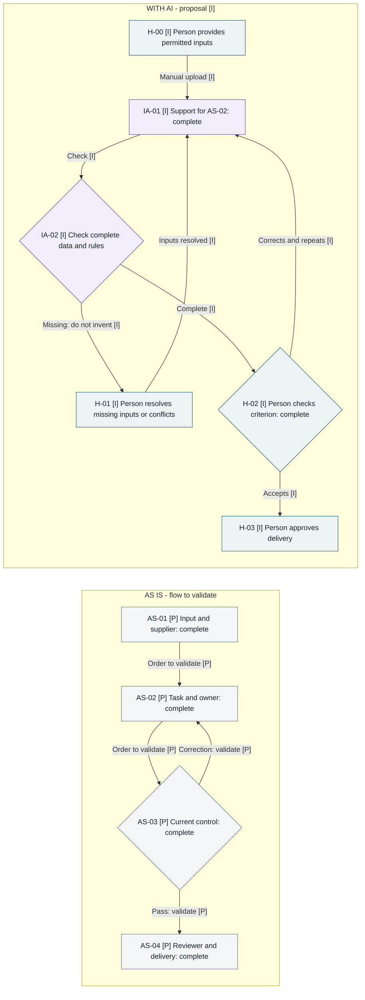

# Visual process map: <client> · <area> · <process>

- Version, date and scope: <record>
- Source profile and owner: <references>
- Status: incomplete scaffold | reconstruction for validation | reviewed by owner
- Editable source and shareable figure: <authorized paths and version>
- Reviewed by: <person, date and evidence, or pending>

## Comparative diagram

Complete the diagram and place it at the start of the relevant diagnostic. For an area, show inputs, processes, owners and cross-area deliveries; for a champion, show the chosen process's steps and decisions. Reuse IDs and versions to avoid conflicting maps.

**[C] Confirmed:** source and date supporting that exact claim; a summary is not a verified transcript or current approval. **[I] Inferred or proposed:** explicit hypothesis. **[P] Pending:** evidence or a decision is missing, with a validation owner. Mark nodes, owners, decisions and connections; confirming one step does not confirm the whole flow's order.

This example is a generic scaffold: all current steps are [P] and the entire proposal [I]. Replace or remove nodes and connections that do not apply; do not present them as client facts. A reviewed proposal remains a proposal: record its approval separately without turning it into an observed as is.

Gray: current process. Purple: proposed AI support. Blue: human review or decision. Text, IDs and shapes also distinguish functions; meaning does not rely on color alone. If the flow is unobserved, label the as is as a reconstruction or hypothesis for validation.

## Exact intervention point

| Intervention ID | Affected current step | Support type | Input and output | Limit and human review |
|---|---|---|---|---|
| IA-01 [I] | AS-02 [P] | <AI at runtime / automation / built with AI and operated without a model / undecided> | <permitted input and verifiable output> | <what it does not decide, reviewer, criterion and exception> |
| IA-02 [I] | AS-03 [P] | <support type to define> | <data, rules and check result> | <when it stops and who resolves missing inputs> |

Distinguish AI participation in building software from its use when running the process. Do not label a deterministic application as consulting a model at runtime without evidence. Identify approved sources and rules before calculating or acting. If a step is simply removed or simplified, say so without attributing it to AI.

## Map traceability

| Node or connection ID | Mark | Source and date | Step or review owner | Pending item and validation owner |
|---|---|---|---|---|
| <ID or AS-01 to AS-02> | <C/I/P> | <evidence or no evidence> | <confirmed, inferred or pending role> | <question and owner, or not applicable with reason> |

Unknown inputs, times, permissions and owners remain [P]; do not fill them to make the diagram look complete. A map does not authorize data or replace the pilot's autonomy agreement. Do not infer savings from the number of boxes or steps.

## Delivery and review

- [ ] As is and proposal visible at the start of each profile, with inputs, outputs, roles, decisions, exceptions and correction loops. A table or link to an unseen diagram is insufficient.
- [ ] Each intervention maps to its current step, AI participation type, limits and human review; the first candidate intervention is identified.
- [ ] [C]/[I]/[P] marks and traceability agree across both views, including connections and owners.
- [ ] Editable source retained and figure rendered as SVG or PNG; shareable PDF if delivered outside the viewer. Same version in profile, source and export, within the client's authorized environment.
- [ ] Figure inspected at reading size: legible labels, clear arrows, no clipping or overlap. Owner review recorded or explicitly pending.

The area map and its champion details must agree. Update affected items when sources, rules or owners change and review the next practice. Figures and completed client copies stay outside the Delivery Kit and any panel that only accepts data-free templates.
