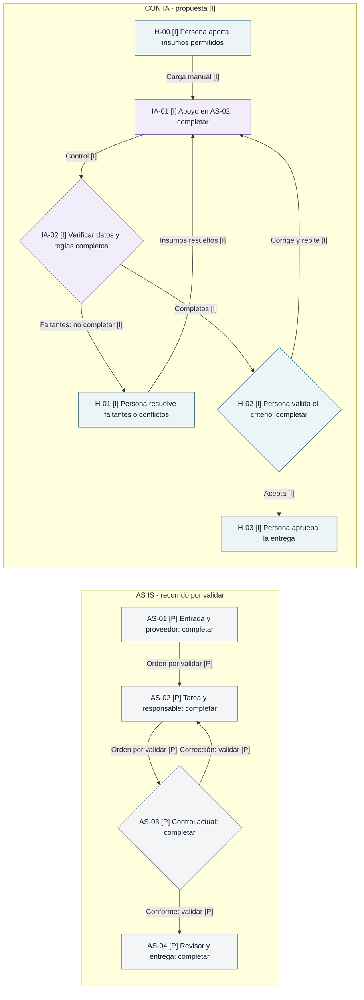

# Mapa visual del proceso: <cliente> · <área> · <proceso>

- Versión, fecha y alcance: <registro>
- Ficha de origen y dueño: <referencias>
- Estado: andamiaje sin completar | reconstrucción para validar | revisado por el dueño
- Fuente editable y figura compartible: <rutas autorizadas y versión>
- Revisó: <persona, fecha y evidencia, o pendiente>

## Diagrama comparativo

Complete el diagrama y colóquelo al inicio del diagnóstico correspondiente. En el área muestre entradas, procesos, responsables y entregas entre áreas; en el champion, los pasos y decisiones del proceso elegido. Reutilice IDs y versiones para no mantener mapas contradictorios.

**[C] Confirmado:** fuente y fecha que sustentan exactamente esa afirmación; un resumen no equivale a transcripción verificada ni aprobación actual. **[I] Inferido o propuesto:** hipótesis explícita. **[P] Pendiente:** falta evidencia o decisión y tiene responsable de validación. Marque nodos, responsables, decisiones y conexiones; confirmar un paso no confirma el orden de todo el flujo.

Este ejemplo es andamiaje genérico: todos los pasos actuales están [P] y toda la propuesta [I]. Sustituya o elimine los nodos y conexiones que no correspondan; no los presente como hechos del cliente. Una propuesta revisada sigue siendo propuesta: registre su aprobación aparte, sin convertirla en un as is observado.

Gris: proceso actual. Morado: apoyo propuesto de IA. Azul: revisión o decisión humana. Los textos, IDs y formas también distinguen las funciones; el significado no depende solo del color. Si el recorrido no está observado, rotule el as is como reconstrucción o hipótesis para validar.

## Punto exacto de intervención

| ID de intervención | Paso actual afectado | Tipo de apoyo | Entrada y salida | Límite y revisión humana |
|---|---|---|---|---|
| IA-01 [I] | AS-02 [P] | <IA en operación / automatización / construido con IA y operado sin modelo / por definir> | <insumo permitido y resultado verificable> | <qué no decide, quién revisa, criterio y excepción> |
| IA-02 [I] | AS-03 [P] | <tipo de apoyo por definir> | <datos, reglas y resultado del control> | <cuándo se detiene y quién resuelve los faltantes> |

Distinga la participación de IA en la construcción de software de su uso al ejecutar el proceso. No marque una aplicación determinista como si consultara un modelo en operación sin evidencia. Identifique fuente y reglas aprobadas antes de calcular o actuar. Si un paso solo se elimina o simplifica, indíquelo sin atribuirlo a IA.

## Trazabilidad del mapa

| ID de nodo o conexión | Marca | Fuente y fecha | Responsable del paso o revisión | Pendiente y quién lo valida |
|---|---|---|---|---|
| <ID o AS-01 a AS-02> | <C/I/P> | <evidencia o sin evidencia> | <rol confirmado, inferido o pendiente> | <pregunta y responsable, o no aplica con motivo> |

Los insumos, tiempos, permisos y responsables desconocidos quedan [P]; no se completan para que el diagrama parezca terminado. El mapa no autoriza datos ni sustituye el acuerdo de autonomía del piloto. No se deduce ahorro de la cantidad de cajas o pasos.

## Entrega y revisión

- [ ] As is y propuesta visibles al inicio de cada ficha, con entrada, salida, roles, decisiones, excepciones y retorno para corregir. No basta una tabla ni un enlace a un diagrama sin mostrarlo.
- [ ] Cada apoyo se conecta con el paso actual afectado, su tipo de participación de IA, límites y revisión humana; se señala la primera intervención candidata.
- [ ] Marcas [C]/[I]/[P] y trazabilidad coherentes en ambas vistas, incluidas conexiones y responsables.
- [ ] Fuente editable conservada y figura renderizada en SVG o PNG; PDF compartible si se entrega fuera del visor. Misma versión en ficha, fuente y exportación, dentro del entorno autorizado del cliente.
- [ ] Figura revisada a tamaño de lectura: textos legibles, flechas claras, sin recortes ni superposiciones. Registro de revisión del dueño o etiqueta explícita de pendiente.

El mapa del área y sus detalles por champion deben concordar. Actualice lo afectado cuando cambien fuentes, reglas o responsables y revise la práctica siguiente. Las figuras y copias con contenido del cliente permanecen fuera del Delivery Kit y de cualquier panel que solo admita plantillas sin datos.
